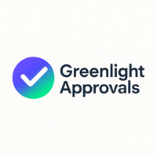

<section class="ms-hero ms-hero--overlap">

  <h1>A senior NetSuite advisor on your side of the table</h1>
  
Retainer-based advisory for finance and operations teams, mid-implementation or post-go-live. You work directly with me, a certified consultant with thirteen years in NetSuite. No juniors, no handoffs.

  

    <a href="/contact/" class="cta-primary">Discuss your NetSuite needs</a>
    <a href="/about/" class="cta-secondary">View Services</a>
  

  <dl>
    

      <dt>13 years in NetSuite</dt>
      <dd>Five running it from the inside, then several more inside NetSuite Solution Providers.</dd>
    

    

      <dt>Certified ERP Consultant</dt>
      <dd>Also a NetSuite Certified Administrator and PMP.</dd>
    

    

      <dt>One consultant</dt>
      <dd>I scope the work and I do the work, in every session.</dd>
    

  </dl>

</section>

<section class="ms-section ms-section--overlap">

  <a class="ms-service" href="/fractional-netsuite-administrator">
    Monthly retainer
    <h2>Fractional NetSuite Administration</h2>
    
A senior certified admin as a fraction of your team, handling support, configuration, reporting, and training after go-live. Priced by the month, not by the hour.

    Learn More
  </a>
  <a class="ms-service" href="/netsuite-implementation-support">
    Scoped to your project
    <h2>Implementation Support</h2>
    
Your independent expert in the room through an implementation: SOW and scope review, design validation, UAT, and knowledge transfer.

    Learn More
  </a>
  <a class="ms-service" href="/netsuite-customization">
    Quoted to scope
    <h2>Customization &amp; Integrations</h2>
    
SuiteScript and SuiteQL builds, reporting, data migration, and integrations with the tools your business already runs on.

    Learn More
  </a>

</section>

<section class="ms-section ms-section--tint">

## Where I help

Most teams reach out at one of a few moments.

In each case you work with me directly, a senior certified consultant who understands both the software and the accounting and operations work it supports. And because none of the past configuration decisions in your account are mine, I can assess them without defending them.

<ul class="ms-moments">
  <li>The implementation partner has rolled off and no one owns the system.</li>
  <li>The admin seat is empty and the backlog is growing.</li>
  <li>A report or workflow is not doing what the business needs.</li>
  <li>An integration has to connect NetSuite to the rest of the stack.</li>
</ul>

</section>

<section class="ms-section">

## How engagements work

Every engagement starts with a conversation about your NetSuite environment and what is getting in the way. From there we agree on a scope: an ongoing retainer, a fixed-fee project, or implementation support for a defined phase. You work with me directly. I scope the work and I do the work, in every session.

In the first few weeks of an ongoing engagement, I review your configuration, roles, and open issues, and we prioritize together. You get a clear picture of what needs attention and in what order, before committing to a long list of work.

  <a href="/contact/" class="cta-primary">Discuss your NetSuite needs</a>

  <h3>An ongoing retainer includes</h3>
  <ul class="ms-checks">
    <li>A standing weekly working session</li>
    <li>Priority access between sessions</li>
    <li>Ownership of your NetSuite roadmap: what to fix, in what order, and why</li>
  </ul>
  
The scope is fixed each month, so the arrangement stays predictable for both of us.

</section>

<section class="ms-section ms-section--tint">

<figure class="ms-portrait">
  
  <figcaption><strong>Patrick Olson</strong>NetSuite Certified ERP Consultant, PMP</figcaption>
</figure>

## Work directly with Patrick Olson

MySuite is my practice. I am Patrick Olson, a senior consultant with thirteen years in NetSuite: five of them running it from the inside as an administrator and application development manager, then several more delivering implementations inside NetSuite Solution Providers. That is why I work the way I do, on the client's side of the table.

I scope every engagement and I remain your consultant throughout. I live in Barcelona and work daily with clients across North America.

NetSuite Certified ERP Consultant and Certified Administrator, plus SuiteAnalytics, ARM, Multi-Book, and PMP. Hands-on across administration, SuiteScript and SuiteQL, reporting, supply chain, and manufacturing, with integration work in Celigo, Workato, Box, Concur, and Salesforce.

  
  
  
  
  

</section>

<section class="ms-section">

## Recent work

<a href="/about/#recent-work" class="ms-more">Read the details</a>

  <a class="ms-case" href="/about/#client-side-resource-multi-division-horticulture-business">
    Implementation Support
    
Six months behind on go-live, delivered on the reset date.

    Multi-division horticulture business
  </a>
  <a class="ms-case" href="/about/#backlog-cleared-specialty-retail-franchisor">
    Fractional NetSuite Administration
    
Fifty-item backlog cleared in a month.

    Specialty retail franchisor
  </a>
  <a class="ms-case" href="/about/#subscription-operations-at-scale-financial-services-firm">
    Customization &amp; Integrations
    
Thousands of subscriptions and a collections process rebuilt.

    Financial services firm
  </a>

  <h3>Not sure where you stand? NetSuite Health Check, $2,500</h3>
  
A fixed-scope assessment of your NetSuite environment, mid-implementation or post-go-live. You get a findings report ranked by risk and effort, a prioritized remediation roadmap, and a readout call. One way to start, credited toward whatever comes next. It is an option, not a required first step.

  <a href="/netsuite-health-check" class="cta-secondary">See What Is Included</a>

</section>

<section class="ms-section ms-section--tint">

## From the blog

<a href="/blog/" class="ms-more">All articles</a>

<FeaturedPosts />

</section>

<section class="ms-section ms-section--tight">

  
  

    <h3>Greenlight Software</h3>
    
Native NetSuite apps for approvals and accounts payable, built by MySuite. Automated routing, budget checks, and bill entry, with every step human-approved and audit-ready.

    <a href="https://greenlightsoftware.io" target="_blank" class="ms-more">greenlightsoftware.io</a>
  

</section>

<ContactBand />
